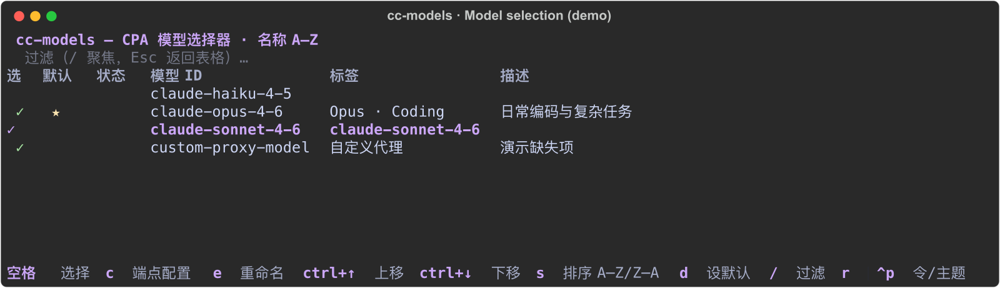
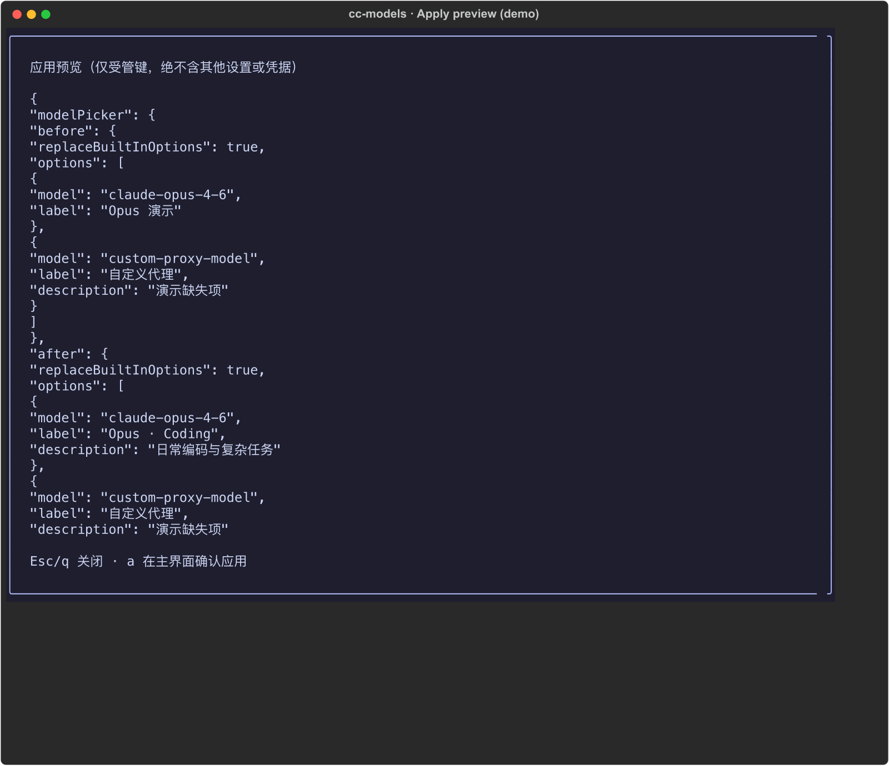

<p align="center">
  
</p>

<h1 align="center">cc-models</h1>

在终端里选择 CPA 模型，生成 Claude Code 的模型菜单。模型请求使用原始 ID，显示名称独立编辑。

<p align="center">
  
  <br />
  
  <br />
  <sub>以上为演示模式，通过 Textual Pilot 操作并导出终端画面，不是系统窗口截图。</sub>
</p>

它是一个配置管理工具，不是代理：不转发请求，不修改 CPA 上游，也不是 CC Switch 的替代品。CC Switch 管理多个工具的整套 provider 配置；cc-models 管理 Claude Code 的 `modelPicker`，也可显式设置默认 `model`。

## 安装

### macOS（Homebrew）

```sh
brew install toRolex/tap/cc-models
```

已安装旧版本的用户升级：

```sh
brew update && brew upgrade toRolex/tap/cc-models
```

安装完成后可用 `cc-models --version` 确认版本。

### 本地源码安装（Unix，无需发布 Release）

```sh
uv tool install .
# 或 pipx install .
```

安装后运行 `cc-models --demo`。演示模式只使用临时配置和固定目录，不访问网络，退出后不影响真实 Claude Code 配置。

开发环境用 uv 同步依赖：`uv sync --group dev`。

## 快速开始

1. 在 shell 中设置 `CPA_API_KEY`（用 `read -s` 避免密钥进入命令历史）：

   ```sh
   read -s CPA_API_KEY
   export CPA_API_KEY
   cc-models
   ```

2. 在界面按 `c` 设置上游地址和令牌环境变量名称，然后按 `r` 拉取模型目录。
3. 勾选模型，按 `a` 确认应用，写入 `~/.claude/settings.json` 的 `modelPicker`。
4. 按 `q` 退出，重启 Claude Code 看到新菜单。

配置文件必须已存在且是严格 JSON 对象（不支持 JSONC 注释）。首次启动仅在本地状态文件不存在时导入已有 `modelPicker`，本地状态默认保存在 `~/.cc-models`。

### 密钥解析顺序

| 优先级 | 来源 | 条件 |
| --- | --- | --- |
| 1 | 环境变量 `CPA_API_KEY`，或在 `c` 面板设置的变量名 | 值非空 |
| 2 | 所选配置的 `env.ANTHROPIC_AUTH_TOKEN`，为空时尝试顶层 `ANTHROPIC_AUTH_TOKEN` | 值为非空字符串，上游地址与配置一致 |
| 3 | 所选配置的 `env.ANTHROPIC_API_KEY`，为空时尝试顶层 `ANTHROPIC_API_KEY` | 值为非空字符串，上游地址与配置一致 |

令牌值不保存在本地状态。

## 命令行

```sh
cc-models list                  # 列出本地缓存的模型
cc-models refresh               # 拉取模型目录
cc-models apply --dry-run       # 预览受管字段变更
cc-models apply --yes           # 写入 modelPicker
cc-models backups               # 列出备份
cc-models restore --backup /path/to/backup --yes
```

所有全局选项放在子命令之前：

```sh
cc-models --base-url https://example.com/v1 refresh
cc-models --settings /path/to/user-config.json --state-dir /path/to/local-state list
```

非回环 HTTP 地址必须显式允许明文传输：TUI 配置提供确认选项，CLI 使用 `--allow-insecure-http`。重定向被拒绝，不要向不可信地址发送凭据。

## 界面按键

| 键 | 作用 |
| --- | --- |
| `j` / `k` | 表格中下移、上移（搜索框和弹窗中为普通输入） |
| `/` | 聚焦搜索框，Esc 返回列表 |
| 空格 | 勾选或取消，焦点跟随原模型 ID |
| `e` | 编辑显示名称和描述（留空清除描述，模型 ID 不变） |
| `d` | 设置默认模型，再按一次恢复原默认 |
| `Ctrl+↑/↓` | 调整精选顺序（应用顺序，不影响表格显示排序） |
| `s` | 切换表格按模型 ID 排序的方向（A–Z / Z–A），偏好持久保存 |
| `c` | 端点配置（上游、令牌变量名、是否替换内置模型列表） |
| `r` | 刷新模型目录 |
| `p` | 预览受管字段变更 |
| `a` | 应用确认弹窗 |
| `Ctrl+P` | 命令/主题面板（仅限保留终端默认背景的 ANSI 主题） |
| `q` | 退出 |

## 安全边界

- 应用只更新 `modelPicker` 和显式设置的默认 `model`，其它配置值保持不变，但 JSON 缩进和格式可能变化。
- 应用前在配置文件旁创建权限为 0600 的备份，再原子替换；恢复会还原整个配置文件并先备份当前内容。恢复入口目前是 CLI。
- 同一配置目标的本工具实例共用写锁，内容变化会拒绝应用。CC Switch 等不遵守该锁的程序仍可能在最终检查后抢写，不要同时使用两个配置管理器。
- 本工具只请求模型目录，不发送聊天或能力测试请求；模型是否可用由 CPA 上游决定。
- 仅在 Unix 环境验证过。
- 上游新增模型不会自动选中；刷新失败不清空选择；空精选列表禁止应用。

## 开发

质量门（lint、format、pyright、构建、验包、formula 生成、测试）与 CI 细节见 [docs/development.md](docs/development.md)，本地一条命令运行全部：

```sh
./scripts/verify.sh
```

测试使用临时配置、演示数据和本机测试 HTTP 服务，不修改真实配置。
