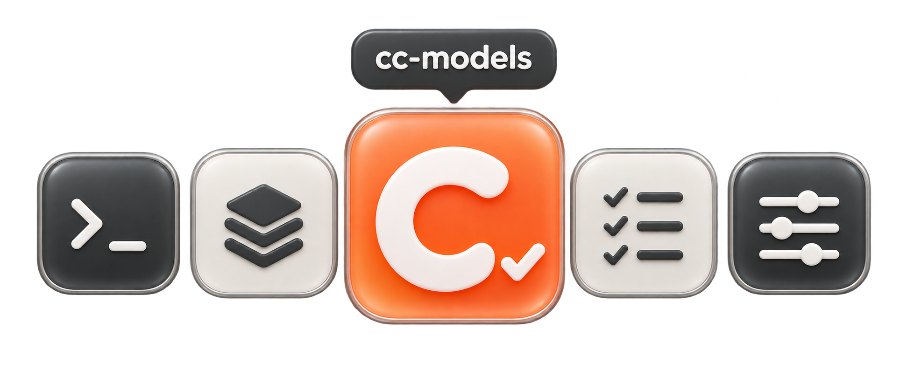
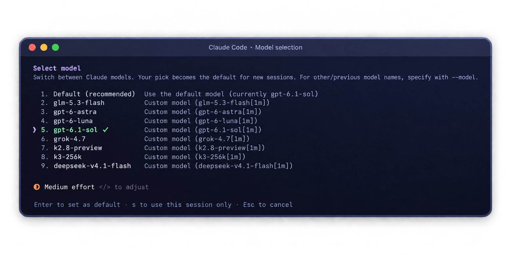

<p align="center">
  
</p>

<h1 align="center">cc-models</h1>

<p align="center">从 CPA 获取模型列表，配置 Claude Code 的模型菜单。</p>

<p align="center">
  <a href="#安装"></a>
  <a href="#快速开始"></a>
  <a href="#安装"></a>
</p>

<p align="center"><code>brew install toRolex/tap/cc-models</code></p>

<p align="center">
  <a href="#快速开始">快速开始</a> · <a href="#使用方式">使用方式</a> · <a href="#配置与备份">配置与备份</a> · <a href="#常见问题">常见问题</a>
</p>

<br />

<p align="center">
  
</p>

## 功能

在终端里搜索和选择模型，编辑菜单名称与描述，调整顺序，设置默认模型。预览后写入 Claude Code 的 `modelPicker`。

模型名称和描述可以自定义，匹配 CPA 目录时使用原始模型 ID。刷新目录后，新增模型需要手动勾选。未设置默认模型时，工具保留原来的默认值。

## 安装

### macOS · Homebrew

```sh
brew install toRolex/tap/cc-models
cc-models --version
```

升级：

```sh
brew update && brew upgrade toRolex/tap/cc-models
```

### Unix · 源码安装

需要 Python 3.11 或以上。下载源码，在项目根目录运行：

```sh
uv tool install .
# 或 pipx install .
```

### 试用界面

```sh
cc-models --demo
```

演示模式使用临时配置和固定模型列表，不连接 CPA，也不修改 Claude Code 配置。

## 快速开始

准备好 `~/.claude/settings.json`。文件需为 JSON 对象，不支持 JSONC 注释或符号链接。

### 启动

输入 CPA 令牌并启动。使用 `read -s` 输入的令牌不会进入命令历史。

```sh
read -s CPA_API_KEY
export CPA_API_KEY
cc-models
```

也可以读取 Claude Code 配置中的令牌，见[凭据读取](#凭据读取)。

### 选择模型

按 `c` 设置 CPA 地址和令牌环境变量名，按 `r` 获取模型列表。

用空格勾选模型，按 `e` 编辑名称和描述，按 `d` 设置默认模型。用 `Ctrl+↑/↓` 调整已选模型的菜单顺序。

写入的模型 ID 默认带 `[1m]` 后缀。如果上游不支持，选中模型后按 `m` 勾选「不加 1m」。

### 应用配置

按 `p` 查看差异，按 `a` 确认写入。按 `q` 退出，重启 Claude Code 查看菜单。

首次启动时，工具从现有 `modelPicker` 导入选择。之后读取本地状态，默认保存在 `~/.cc-models`。

## 使用方式

### 界面按键

| 键 | 作用 |
| --- | --- |
| `j` / `k` | 在表格中下移或上移，在搜索框和弹窗中输入文字 |
| `/` · `Esc` | 聚焦搜索框或返回列表 |
| 空格 | 勾选或取消模型 |
| `e` | 编辑已选模型的名称和描述，留空清除描述 |
| `m` | 切换已选模型的「不加 1m」 |
| `d` | 将已选模型设为默认，再按一次则保留原默认值 |
| `Ctrl+↑/↓` | 调整已选模型的菜单顺序 |
| `s` | 切换表格升序或降序，不改变菜单顺序，工具会保存排序偏好 |
| `c` | 配置 CPA 地址、令牌变量名和是否替换内置模型列表 |
| `r` | 刷新模型列表 |
| `p` | 预览配置差异 |
| `a` | 打开应用确认弹窗 |
| `Ctrl+P` | 打开命令或主题面板，主题限于保留终端默认背景的 ANSI 主题 |
| `q` | 退出 |

### 命令行

```sh
cc-models list                  # 查看缓存模型和已选模型的输出 ID
cc-models refresh               # 获取模型列表
cc-models apply --dry-run       # 预览配置差异
cc-models apply --yes           # 写入模型菜单
cc-models backups               # 列出备份
cc-models restore --backup /path/to/backup --yes
```

全局选项放在子命令之前：

```sh
cc-models --base-url https://example.com/v1 refresh
cc-models --settings /path/to/user-config.json --state-dir /path/to/local-state list
```

`--base-url` 和 `--allow-insecure-http` 用于 CLI 子命令。TUI 的地址在 `c` 面板中设置。

非回环 HTTP 地址需要允许明文传输，在 TUI 中确认，或在 CLI 中传入 `--allow-insecure-http`。工具不跟随重定向。

## 配置与备份

工具更新 `modelPicker`，设置默认模型时还会更新 `model`。其他配置值保持不变，JSON 的缩进和格式可能改变。已选模型列表为空时不能应用。

有变更时，工具在配置文件旁创建完整备份，再替换原文件。备份权限为 `0600`，可能包含配置中的密钥，请勿公开上传。

用 `cc-models backups` 查看备份，用 `cc-models restore --backup /path/to/backup --yes` 恢复。恢复会替换整个配置文件，并先备份当前内容。

应用期间不要用其他程序编辑同一个配置文件。工具会加写锁并检查内容变化，其他程序可能不遵守该锁。

### 凭据读取

工具优先读取 `CPA_API_KEY`，也可以在 `c` 面板指定其他环境变量名。

环境变量为空时，如果 CPA 地址与所选 Claude Code 配置一致，工具按以下顺序读取配置令牌：

1. `env.ANTHROPIC_AUTH_TOKEN`，为空时读取顶层同名字段。
2. `env.ANTHROPIC_API_KEY`，为空时读取顶层同名字段。

令牌必须是非空字符串。工具不将令牌值保存到本地状态文件。

## 常见问题

### 为什么模型 ID 带 `[1m]`？

Claude Code 用这个后缀声明 1M 上下文窗口。它不会改变上游模型的实际窗口大小。

cc-models 匹配目录时使用原始 ID，写入配置时默认追加 `[1m]`。按 `m` 可以关闭单个模型的追加行为，默认模型也遵循这个设置。旧状态和新选模型默认都会追加。

原始 ID 已带 `[1m]` 时不会重复追加。「不加 1m」只关闭追加行为，不会删除原始 ID 中的后缀。

如果上游拒绝带后缀的 ID，勾选「不加 1m」后重新应用。

### 上游删除了模型，为什么菜单里还在？

刷新只更新模型目录，不删除已选模型。目录中找不到的已选模型会标为「缺失」。用空格取消勾选，按 `a` 应用，再重启 Claude Code。

有缓存时，启动会读取缓存，不自动刷新。没有缓存时会尝试获取一次。刷新失败后，工具保留现有选择。

### Claude Code 提示模型不在 model catalog 中，怎么办？

CPA 的模型列表与 Claude Code 的内置目录不同。先检查上游是否接受写入的模型 ID，包括 `[1m]` 后缀。cc-models 只获取目录，不测试模型调用。

如果 Claude Code 显示的窗口大小与后端不同，可以用 `CLAUDE_CODE_MAX_CONTEXT_TOKENS` 设置后端的实际值。

`behavesAs` 和 `modelOverrides` 会改变 Claude Code 对模型行为的判断。cc-models 保留导入的 `behavesAs`，不自动生成映射。

`CLAUDE_CODE_DISABLE_UNKNOWN_MODEL_WINDOW_ENFORCEMENT=1` 会关闭未知模型的窗口检查，改由 API 返回上下文超限错误。如果网关改写了错误信息，Claude Code 可能无法恢复请求。

详见 [Claude Code 上下文窗口配置](https://code.claude.com/docs/en/model-config#correct-the-window-for-a-gateway-or-custom-model-id)。

## 开发

```sh
uv sync --group dev
./scripts/verify.sh
```

验证脚本运行 lint、格式检查、pyright、构建、包检查、Homebrew formula 生成和测试。详见[开发文档](docs/development.md)。

## 开源协议

本项目使用 [MIT 协议](LICENSE)。
